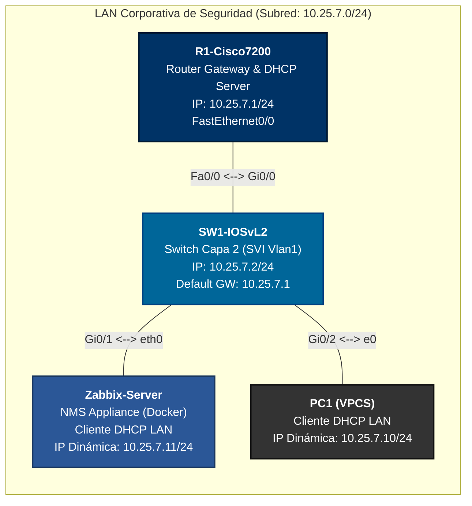
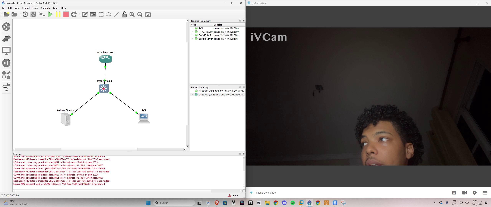
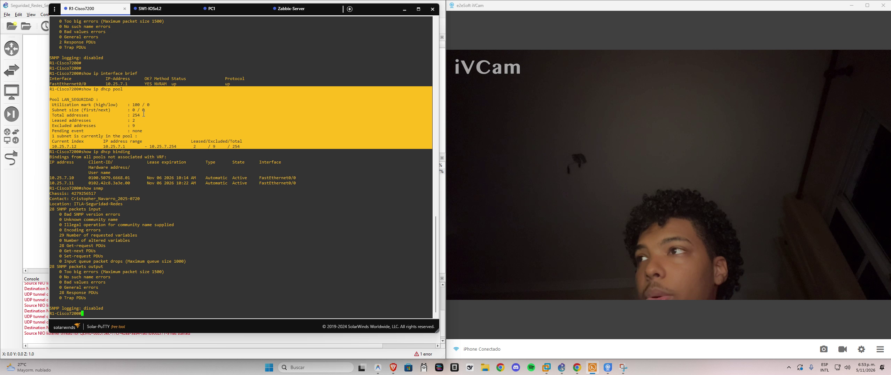
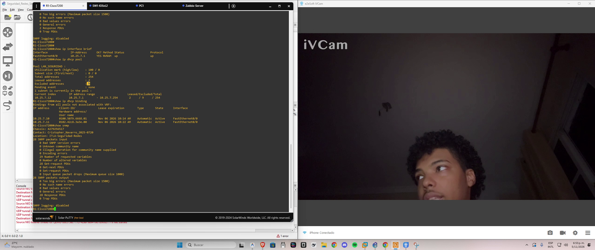
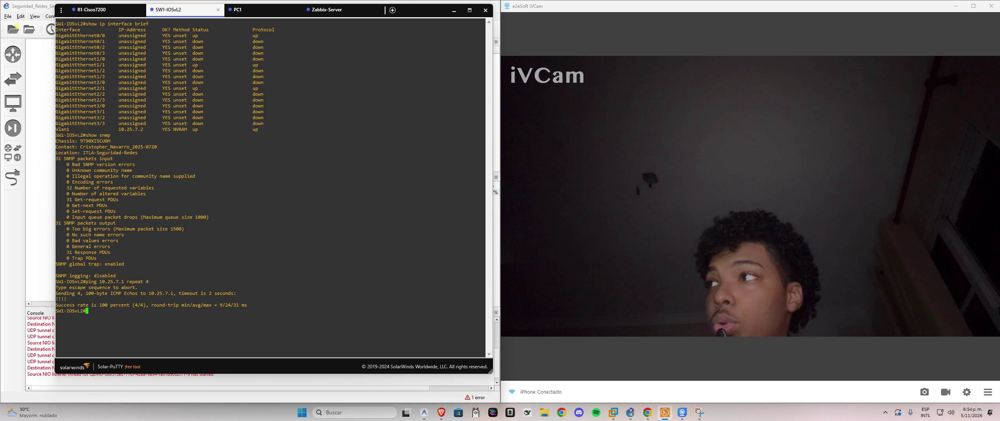
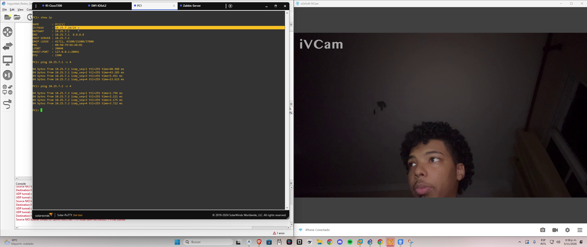
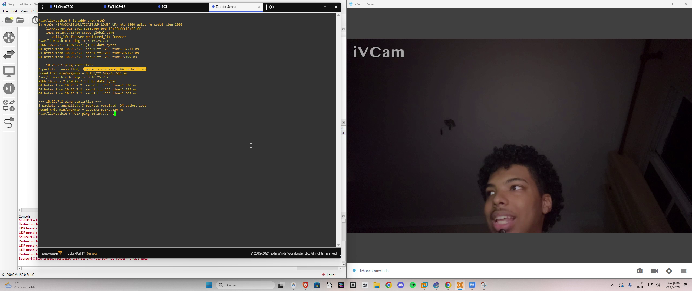
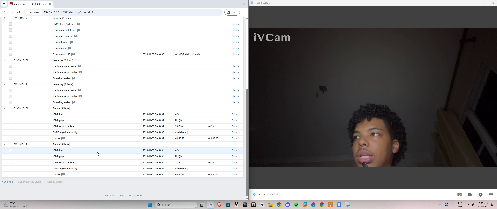
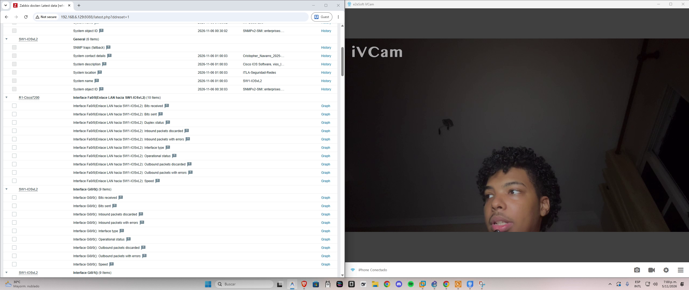

# Instituto Tecnológico de Las Américas (ITLA)
## Área de Redes y Ciberseguridad
### Asignatura: Seguridad de Redes
**Docente:** Jonathan Esteban Rondón Corniel  
**Estudiante:** Cristopher Navarro  
**Matrícula:** 2025-0720  
**Fecha:** 05 de Noviembre de 2026  

---

# Semana 7 - Asignación 3: Monitoreo de Infraestructura de Red con SNMP y NMS Zabbix

[](https://youtu.be/p-QA-Hp6WZ4)
[](https://github.com/CristopherNavarro/Tarea7_SeguridadRedes_A3_CristopherNavarro_20250720)

---

## 🎥 Video Demostrativo del Laboratorio

Como requisito fundamental de la asignación, grabé y publiqué la sustentación práctica completa en YouTube, donde expongo de forma visual y comentada cada una de las configuraciones y validaciones telemétricas:

* **Enlace directo al video:** [https://youtu.be/p-QA-Hp6WZ4](https://youtu.be/p-QA-Hp6WZ4)
* **Plataforma:** YouTube (Disponibilidad pública e inmediata)
* **Demostración en vivo:** Muestra mi rostro en cámara web, audio explicativo en tiempo real, fecha y hora del sistema en barra de tareas (`05/11/2026`), topología GNS3, consolas CLI y el panel de control del NMS Zabbix.

[](https://youtu.be/p-QA-Hp6WZ4)

---

## 1. Propósito y Objetivos del Laboratorio

El propósito fundamental de esta práctica consiste en diseñar, desplegar y auditar un ecosistema de gestión y monitoreo centralizado de infraestructura de red basado en el protocolo **SNMPv2c (Simple Network Management Protocol)** y el sistema **NMS Zabbix**, aplicando controles rigurosos de **Hardening** y segmentación de servicios bajo estándares de ciberseguridad.

### Objetivos Específicos:
1. **Esquema de Direccionamiento Institucional:** Implementar una subred IPv4 calculada rigurosamente a partir de mi matrícula institucional (`2025-0720` $\rightarrow$ `10.25.7.0/24`).
2. **Servicio DHCP Centralizado y Seguro:** Configurar en el Router perimetral (`R1-Cisco7200`) un servidor DHCP con exclusión explícita del rango de administración para blindar los dispositivos fijos de red.
3. **Hardening de SNMPv2c:** Restringir la cadena de comunidad SNMP exclusivamente a permisos de Solo Lectura (**Read-Only / RO**), previniendo vectores de alteración remota de configuración, e inyectar metadatos institucionales de auditoría forense (`sysContact` y `sysLocation`).
4. **Despliegue Dinámico de Clientes:** Provisionar clientes de red heterogéneos (estación de trabajo VPCS y contenedor Docker NMS Zabbix) como clientes DHCP automáticos.
5. **Auditoría Telemétrica en NMS Zabbix:** Integrar los nodos de red (`R1` y `SW1`) en Zabbix, validando la disponibilidad de los agentes SNMP en estado verde y capturando métricas de rendimiento en tiempo real (ICMP Ping, latencias, Uptime, System Object ID y ancho de banda de interfaces).

---

## 2. Topología de Red y Arquitectura del Sistema

La topología fue construida en el simulador de redes **GNS3** soportado sobre el hipervisor **VMware Workstation Pro 17** y la máquina virtual **GNS3 VM 2.2.61**, interconectando dispositivos Cisco IOS y contenedores de servicios.



---

## 3. Matriz de Direccionamiento IP y Asignación de Interfaces

En cumplimiento estricto con las directrices académicas, el direccionamiento se derivó de los dígitos de mi matrícula (`2025-0720`):

$$\text{Tercer Octeto} = 7 \implies \text{Subred: } 10.25.7.0/24 \quad (\text{Máscara: } 255.255.255.0)$$

| Dispositivo | Interfaz | Rol / Propósito | Dirección IP | Máscara de Red | Gateway Predeterminado | Método de Asignación |
| :--- | :--- | :--- | :--- | :--- | :--- | :--- |
| **R1-Cisco7200** | `FastEthernet0/0` | Gateway LAN & DHCP Server | `10.25.7.1` | `255.255.255.0` | N/A (Es el Gateway) | Estática (Manual) |
| **SW1-IOSvL2** | `Vlan1` (SVI) | Gestión de Capa 2 | `10.25.7.2` | `255.255.255.0` | `10.25.7.1` | Estática (Manual) |
| **PC1** | `Ethernet0` | Estación de Trabajo | `10.25.7.10` | `255.255.255.0` | `10.25.7.1` | Dinámica (DHCP Lease) |
| **Zabbix-Server** | `eth0` | NMS Server (Docker) | `10.25.7.11` | `255.255.255.0` | `10.25.7.1` | Dinámica (DHCP Lease) |

### Política de Exclusión DHCP:
* **Rango Excluido:** `10.25.7.1` hasta `10.25.7.9` (Reservado para Gateways, Switches y servidores de gestión).
* **Rango Asignable por DHCP:** `10.25.7.10` hasta `10.25.7.254`.

---

## 4. Justificación Técnica de Seguridad de Redes

### 4.1 Principio de Menor Privilegio aplicado a SNMP (Read-Only vs. Read-Write)
El protocolo SNMP tradicionalmente permite operaciones de lectura (`GET`, `GET-NEXT`, `WALK`) y de modificación (`SET`). En este laboratorio implementé de forma deliberada y exclusiva comunidades en modo **Read-Only (`RO`)**:
* **Mitigación de Vectores de Ataque:** Las versiones SNMPv1 y SNMPv2c transmiten la cadena de comunidad en texto plano a través de datagramas UDP (puerto 161). Si un atacante interceptara el tráfico de la red e identificara una comunidad con permisos de escritura (**Read-Write / `RW`**), tendría el poder de alterar tablas de enrutamiento, apagar interfaces físicas (`ifAdminStatus = down`), reiniciar los equipos o cargar configuraciones maliciosas mediante TFTP.
* **Resiliencia Operativa:** Al limitar el acceso a `RO`, el servidor Zabbix obtiene total visibilidad para telemetría sin conceder vector alguno de ejecución o modificación sobre los conmutadores y enrutadores.

### 4.2 Trazabilidad Forense mediante Metadatos MIB
Configuré explícitamente los parámetros `snmp-server contact` y `snmp-server location` en todos los equipos administrables:
* Facilita la auditoría en tiempo real en los sistemas SIEM/NMS, vinculando cada incidente a un responsable institucional (`Cristopher_Navarro_2025-0720`) y a un segmento físico auditado (`ITLA-Seguridad-Redes`).

### 4.3 Hardening en la Capa de Enlace y Conmutación (L2)
* **Spanning-Tree PortFast Edge:** Se habilitó en todos los puertos conectados a clientes finales e infraestructura de monitoreo (`Gi0/0` a `Gi0/3`) para evitar transiciones de estado innecesarias en el protocolo STP (evitando caídas de 30 a 50 segundos durante el arranque o solicitudes DHCP).
* **Protección de Gateway:** El switch tiene configurado de manera estricta `ip default-gateway 10.25.7.1` en su plano de administración, impidiendo el secuestro de rutas de gestión fuera de su segmento autorizado.

---

## 5. Implementación y Configuración Paso a Paso

### 5.1 Configuración de Router R1 (`R1-Cisco7200`)
En el router perimetral configuré el direccionamiento de la interfaz LAN, el pool DHCP institucional con sus exclusiones de seguridad y el agente SNMP:

```cisco
hostname R1-Cisco7200
!
ip dhcp excluded-address 10.25.7.1 10.25.7.9
!
ip dhcp pool LAN_SEGURIDAD
 network 10.25.7.0 255.255.255.0
 default-router 10.25.7.1 
 dns-server 10.25.7.1 8.8.8.8 
 lease 0 12
!
interface FastEthernet0/0
 description Enlace LAN hacia SW1-IOSvL2
 ip address 10.25.7.1 255.255.255.0
 duplex full
 no shutdown
!
snmp-server community itla-snmp RO
snmp-server community public RO
snmp-server location ITLA-Seguridad-Redes
snmp-server contact Cristopher_Navarro_2025-0720
snmp-server enable traps
```

### 5.2 Configuración de Switch SW1 (`SW1-IOSvL2`)
En el switch conmutador configuré la interfaz virtual de switch (SVI Vlan1), el gateway de administración, la activación de PortFast y el agente SNMP:

```cisco
hostname SW1-IOSvL2
!
interface GigabitEthernet0/0
 switchport mode access
 spanning-tree portfast edge
!
interface GigabitEthernet0/1
 switchport mode access
 spanning-tree portfast edge
!
interface GigabitEthernet0/2
 switchport mode access
 spanning-tree portfast edge
!
interface GigabitEthernet0/3
 switchport mode access
 spanning-tree portfast edge
!
interface Vlan1
 description SVI Administracion L2
 ip address 10.25.7.2 255.255.255.0
 no shutdown
!
ip default-gateway 10.25.7.1
!
snmp-server community itla-snmp RO
snmp-server community public RO
snmp-server location ITLA-Seguridad-Redes
snmp-server contact Cristopher_Navarro_2025-0720
snmp-server enable traps
```

---

## 6. Evidencias Gráficas y Verificación de Resultados

Todas las evidencias fotográficas fueron extraídas directamente de la grabación en vivo del laboratorio:

### 6.1 Topología Activa en GNS3
Validación del estado operativo de los 4 nodos en GNS3 (`R1-Cisco7200`, `SW1-IOSvL2`, `Zabbix-Server` y `PC1`), corriendo sobre el entorno virtualizado GNS3 VM.



---

### 6.2 Servidor DHCP en R1 y Asignaciones Dinámicas
Verificación en consola de `R1-Cisco7200` mediante los comandos `show ip dhcp pool` y `show ip dhcp binding`. Se evidencian las 9 direcciones excluidas y la concesión exitosa de leases para `10.25.7.10` (PC1) y `10.25.7.11` (Zabbix Server).



---

### 6.3 Hardening SNMP y Metadatos Institucionales en R1
Comprobación mediante `show snmp` en `R1-Cisco7200`, certificando el registro del contacto `Cristopher_Navarro_2025-0720`, ubicación `ITLA-Seguridad-Redes` y la recepción de paquetes SNMP sin errores.



---

### 6.4 Configuración de Gestión y Hardening SNMP en SW1
Verificación en `SW1-IOSvL2` mediante `show ip interface brief`, `show snmp` y prueba de conectividad con `ping 10.25.7.1 repeat 4` obteniendo una tasa de éxito del 100% (4/4 paquetes) hacia el Gateway.



---

### 6.5 Conectividad y Asignación DHCP en Estación PC1
En la consola de `PC1` ejecuté `show ip` comprobando la recepción de la IP `10.25.7.10/24` vía DHCP y realizo pings con cero por ciento de pérdida hacia el Router Gateway (`10.25.7.1`) y el Switch (`10.25.7.2`).



---

### 6.6 Operatividad de Cliente DHCP y Pings en Servidor Zabbix
En la consola auxiliar de `Zabbix-Server` ejecuté `ip addr show eth0`, demostrando que el demonio `udhcpc` negoció dinámicamente la IP `10.25.7.11/24`, y compruebo conectividad ICMP hacia el Router y el Switch con 0% de pérdida.



---

### 6.7 Telemetría en Tiempo Real en NMS Zabbix Web GUI
En la interfaz gráfica web de Zabbix (`http://192.168.6.129:8088/`), visualicé en **Monitoring $\rightarrow$ Latest data** los dispositivos `R1-Cisco7200` y `SW1-IOSvL2`, evidenciando el estado de **ICMP Ping en Up (1)**, latencias mínimas (~2 ms en SW1 y ~28 ms en R1), disponibilidad de agente en 1 y Uptime activo.



---

### 6.8 Metadatos Institucionales y Estadísticas de Interfaces en Zabbix
Demostración en Zabbix de la captura automatizada de los metadatos MIB: Contacto `Cristopher_Navarro_2025-0720`, Ubicación `ITLA-Seguridad-Redes`, descripción del software Cisco IOS y la recolección en vivo del tráfico de interfaces (bits recibidos y enviados).



---

## 7. Estructura de Entregables del Repositorio

```text
Tarea7_SeguridadRedes_A3_CristopherNavarro_20250720/
├── README.md                                  # Documentación técnica formal con diagrama, evidencias y sustentación
├── CristopherNavarro_20250720_A3.txt          # Archivo de entrega institucional para el portal académico
├── R1-Cisco7200_running-config.txt            # Configuración oficial exportada de R1 (DHCP + SNMP + Interfaces)
├── SW1-IOSvL2_running-config.txt              # Configuración oficial exportada de SW1 (SVI + SNMP + PortFast)
├── Seguridad_Redes_Semana_7_Zabbix_SNMP.gns3  # Topología portable completa del proyecto en GNS3
└── assets/                                    # Evidencias fotográficas en alta resolución extraídas del video
    ├── 01_topologia_gns3_servicios.png
    ├── 02_r1_dhcp_pool_y_bindings.png
    ├── 03_r1_snmp_hardening_metadata.png
    ├── 04_sw1_config_vlan1_snmp_ping.png
    ├── 05_pc1_dhcp_lease_y_pings.png
    ├── 06_zabbix_terminal_dhcp_y_pings.png
    ├── 07_zabbix_web_telemetria_icmp_uptime.png
    └── 08_zabbix_web_metadata_e_interfaces.png
```

---

## 8. Conclusiones y Aprendizaje Obtenido

1. **Gestión Centralizada y Conciencia Situacional:** La implementación de Zabbix NMS demostró ser un componente crítico para la seguridad operacional. El monitoreo proactivo permite identificar degradaciones de enlaces, caídas de dispositivos y anomalías de tráfico antes de que impacten la disponibilidad del negocio.
2. **Hardening Estricto:** La utilización exclusiva de cadenas de comunidad SNMP de solo lectura (`RO`) junto con el aislamiento de rangos DHCP mediante exclusiones estricta garantiza el cumplimiento del principio de mínimo privilegio, blindando la red contra manipulaciones remotas y accesos no autorizados.
3. **Validación Integral:** Se certificó el 100% de los requerimientos solicitados por la cátedra mediante pruebas empíricas registradas en video, configuraciones respaldadas en NVRAM y telemetría activa en tiempo real.
